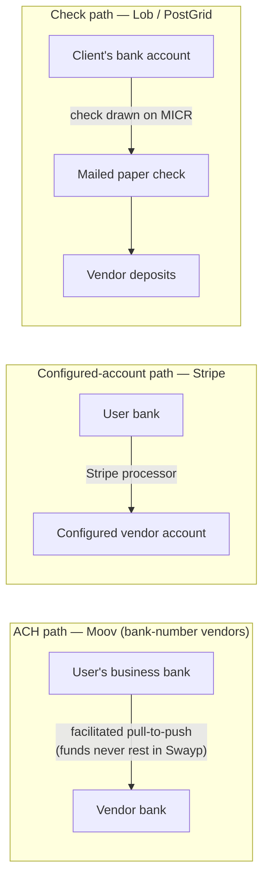

# Swayp — Third-Party Services & Production Requirements

**Part 1: Services & Client Requirements**

- **Audience:** Engineering + Client (Swayp business owner)
- **Version:** 2.0 — **reconciled with the CEO BRD v1.1** ([Swayp BRD Payments.docx.md](Swayp%20BRD%20Payments.docx.md))
- **Date:** 2026-07-17
- **Basis:** Figma *Swayp Finance App Redesign* screens (§2) + the BRD, cross-checked against `swyape-backend`.
- **Companion docs:** [PRD.md](PRD.md) (v2.0), [dashboard-plan.md](dashboard-plan.md) (Part 2 technical plan), [epics/](epics/README.md) (backlog).

> ✅ **BRD reconciliation banner.** The CEO BRD resolved the questions the v1.0 of this doc left open. **Rails are decided: Plaid (bank data) + Stripe (configured-account vendors) + Moov (ACH) + Lob/PostGrid (checks).** **Dwolla, GoCardless, and Stripe Treasury are excluded on record.** **BILL.com and Melio are rejected** (competitor exclusion, BRD §7). The product is **non-custodial** (funds never rest in a Swayp balance) and **USD-only**. Raw bank numbers are **never stored** (tokenized at the provider). **Vendor/payee sanctions + fraud screening is the provider's responsibility, not Swayp's** — Swayp does only lightweight verification of its own paying customers at sign-up. This doc has been updated to reflect all of that; anything that still reads as "open" is genuinely open (§6).

---

> 📞 **Client call clarifications (v1.0-era transcript, folded in 2026-07-18).** A recorded CEO call — predating the v1.1 check-scope addition — confirms the architecture and sharpens five points:
> 1. **Plaid _is_ the customer identity/fraud check.** The BRD §4 "lightweight verification of paying customers at sign-up" = the Plaid bank-connect itself (proving the user owns the account). **No separate KYC/IDV vendor or step.**
> 2. **Bank transfer only — no debit/credit cards.** "We want bank transfer, no card." Never add a card rail; PCI-card handling is out of scope.
> 3. **Money never flows through Swayp — the providers collect and move it.** Moov _collects_ the vendor's routing/account (prefer **client-side tokenization**, e.g. Moov.js/Drops, so raw numbers never reach Swayp's backend — not merely "not persisted"). Stripe executes via a **hosted link + webhook**; "it doesn't happen inside Swayp."
> 4. **"Configured payment account" ≠ a pre-enrolled directory.** Stripe pays a vendor because that vendor has a payment account/link with the processor — not because Swayp searches an "~80% pre-enrolled" biller directory (that old Figma copy is fiction).
> 5. **The wallet is dead, on record.** Swayp can't hold a $500K–$1M reserve, so there is no wallet/stored value. ⚠️ `apps/wallet` is **not dormant today** — the legacy `payment_service` still debits/credits it; it's **legacy-active until E6-S11 removes it** (after the Moov/Stripe execution path lands).
>
> ⚠️ The transcript's scope list is **v1.0** (checks deferred). Follow **v1.1**: checks are in scope and priced (BRD §6.2).

---

## 1. Executive summary

Swayp is a **US business bill-pay web app**: users connect a bank read-only via **Plaid**, add vendors, then pay bills over **ACH (Moov)**, through a **configured payment account (Stripe)**, or by **mailed paper check (Lob/PostGrid)** — with an AI advisor (**Flo**) and auto-detection of recurring bills. It is **non-custodial**: money is always moved by a named, licensed provider, and never rests in a Swayp-controlled balance.

**Two vendor situations drive the design (BRD §2):**
1. **Vendor has a configured payment account** with our processor → pay through **Stripe** with the fewest steps ("confirm, send, done").
2. **Vendor is known only by routing + account number** → pay via **Moov** ACH, after a one-time provider-run verification of that vendor account. Standard 1–3 business days (free); same-day (+$4.99, before the bank cutoff).

Checks (for vendors that only accept paper) print + mail via **Lob/PostGrid** — standard 5–7 business days (per-plan free allowance) or expedited 1–2 business days (+$8.99).

**Critical-path client asks** (start now, in parallel with design): **the Moov platform application (2–4 wks)**, the **written legal opinion** confirming the Moov transfer model is non-custodial under Texas + operating-state law (1–2 wks; a launch prerequisite), **Plaid production + OAuth** (LEI + security questionnaire), and **attorney-drafted ACH-authorization / privacy / ESIGN** language.

---

## 2. Product & screens covered

| Flow | Screens (Figma node ids) |
|---|---|
| Vendors overview & counts | `792:13725` |
| Add vendor (choose method) | `792:16171` |
| Add vendor — search configured-account (Stripe) | `792:16497`, `792:16918` |
| Add vendor — manual (ACH or check) | `792:17275` |
| Mailing details (check) | `793:1707` |
| Bank details (manual ACH) | `793:1326` |
| Save bill — vendor / details / schedule | `829:15081`, `834:3034`, `834:3436` |
| Bill details + invoice / QR modal | `840:12632` |
| Pay — summary + Flo cash context | `840:27719` |
| Connect / select / verify bank (Plaid) | `836:9157`, `836:8618`, `836:8984` |

---

## 3. Third-party services

| # | Service | Category | Named | Purpose (one-line) |
|---|---|---|---|---|
| 3.1 | **Plaid** | Bank data (auth, identity, transactions, balance) | ✅ BRD §5 | Read-only bank connection + data; mints the processor token for Moov |
| 3.2 | **Moov** | Money movement — ACH debit + credit | ✅ BRD §5 | Non-custodial ACH for bank-number vendors; standard + same-day |
| 3.3 | **Stripe** | Money movement — configured-account vendors | ✅ BRD §5 | One-click pay for vendors already set up with our processor |
| 3.4 | **Lob / PostGrid** | Check disbursement | ✅ BRD §5 | Print + USPS-mail physical checks (standard + expedited) |
| 3.5 | **Anthropic Claude** (LLM) + recurring detection | AI (Flo) | ✅ | Phrases Flo cash-context advice; recurring detection is deterministic (Plaid) |
| 3.6 | Invoice OCR + object storage | Document ingestion | ❌ (deferred) | "Auto-import" invoices — **out of scope this release** (BRD §1.2/§6) |
| 3.7 | Business-day / bank-cutoff engine | Scheduling | ❌ implied | Correct send/arrival dates + same-day-ACH & expedited-check eligibility |
| 3.8 | Tax reporting (W-9/TIN + 1099) | Compliance | ✅ §6.2 | 1099 reporting (a Standard-plan feature) |
| 3.9 | **Email** (Postmark/SES) + QR + ABA + logo | Notifications & support | ❌ implied | Email + in-app only this release (SMS/push deferred, BRD §1.2) |
| 3.10 | Observability + secrets manager | Ops | ❌ implied | Money-movement alerting + custody of live financial keys |
| 3.11 | Compliance & legal program | Compliance | ❌ implied | Non-custodial posture, NACHA authorization, GLBA, ESIGN, legal opinion |

### 3.1 Plaid — bank data & connection

**What it does here.** Powers **Select Bank** (`836:8618`), **Connect** (`836:9157`), **Verifying Account** (`836:8984`, "…detecting recurring bills… captures routing so Swayp knows where to pull from when you authorize the ACH"). Feeds real-time balance for **Flo** (`840:27719`) and the masked `…1234` display (`793:1326`). Read-only — Plaid never moves money. **One connection, two purposes (BRD §3.1):** the sign-up link is also proof of ownership for later ACH pulls — the customer is never asked to re-verify their own bank.

**Products / scopes.** Link; Auth; Identity; Transactions (`/transactions/sync`, **up to 12 months** per BRD §3.1); Transactions **Recurring**; Balance; **Processor Token (`processor=moov`)**; `/link/token/create` + `/item/public_token/exchange`. *Not needed:* Plaid IDV — end-user (customer) KYC is lightweight at sign-up (BRD §4); vendor verification belongs to Moov.

**Backend impact.** Plaid integration module: link-token/exchange endpoints (store `access_token`/`item_id` **encrypted** — a provider secret, the one allowed use of field encryption), JWT-verified webhook for `SYNC_UPDATES_AVAILABLE`, Celery `/transactions/sync` + recurring seed. Store **masked** account only. `plaid-python`.

**Note.** If Stripe's own **Financial Connections** is ever used for the configured-account path, keep **one** bank-linking provider (Plaid) to avoid double KYC/cost.

### 3.2 Moov — ACH money movement (replaces the prior "Dwolla" plan)

**What it does here.** The ACH rail for **bank-number vendors** (BRD §3.3): pulls from the connected business bank and pays the vendor. Tied to **Connect/Verify** (`836:9157`, `836:8984`), **manual ACH vendor** (`792:17275`, "1–3 biz days"), **"ACH ****4821 on file"** (`834:3034`), **"Paying from Chase ***4821"** (`840:27719`). Moov transfer webhooks drive the `PENDING→PROCESSING→SUCCESSFUL/FAILED` (+`RETURNED`) state machine.

**Products / scopes.** Moov accounts + transfers; funding source via **Plaid `processor_token`** (no raw account stored); ACH debit + credit; **same-day + standard** ACH; transfer/customer webhooks. Moov is the **licensed money-services provider** — it (not Swayp) carries KYB, sanctions, and fraud obligations for the money movement (BRD §4).

**Non-custodial design (BRD §4, hard).** Use a **facilitated pull-to-push** structure so funds **never rest in a Swayp-controlled balance**. A **written legal opinion** must confirm this model is non-custodial under Texas + operating-state law **before production** (BRD §6.1). Do **not** design a "debit into a Swayp balance, then credit out" two-leg flow — that is custody and is explicitly rejected (BRD §4.1).

**Backend impact.** Moov service behind the `MoneyMovementProvider` interface; replace the free-string `payment_method` with a `rail`/`processor` enum + Moov transfer/funding-source ids; **webhook-driven** state machine tolerating **late ACH returns** (R-codes days later → `RETURNED`); HMAC verification + idempotency; **same-day fee ($4.99) only before the bank cutoff** (§3.7 calendar), else not offered/charged (BRD §3.3).

### 3.3 Stripe — configured-account vendor rail

**What it does here.** For vendors that **already have a configured payment account with our processor** (BRD §3.2), Swayp pays through **Stripe** in one confirmed action; success/failure arrives automatically via webhook; Swayp stores no card/bank credentials for this path. Surfaced as the "configured / Bill Pay Network" experience on Add Vendor (`792:16171`/`16497`), Vendor Details (`792:16918`), and the status badge across `792:13725`, `829:15081`, `834:3034`, `840:27719`.

> ⚠️ **Open item (discovery, not rail):** the screens imply a searchable directory of "~80% pre-enrolled" vendors. **Stripe has no public biller directory**, and **BILL.com/Melio are excluded (BRD §7)**. So *how Swayp discovers which vendors have a configured Stripe payment account* is a real open question (PRD §10-Q1) — likely vendor self-onboarding via Connect or a hosted link, not a bought directory. Ships against a mock `VendorDirectoryProvider` until decided.
>
> **Not used:** **Stripe Treasury** (it holds funds → custody → excluded, BRD §4.1). Stripe here is a payout/settlement processor for already-configured vendors, not a stored-value account.

**Products / scopes (configured-account path).** Stripe **Connect** (connected accounts for vendors that onboard), Global Payouts; live + **restricted** keys, webhook signing secret. Vendors paid this way are Connect accounts (their own bank + KYC handled by Stripe).

**Backend impact.** Stripe rail behind `MoneyMovementProvider`; `processor=STRIPE` for `rail=NETWORK`; PaymentIntent/Payout ids in `provider_reference`; Stripe webhook receiver; a vendor's configured-account ref on `VendorPaymentMethod`. `stripe` SDK.

### 3.4 Lob / PostGrid — check print & mail

**What it does here.** Powers "Physical check by mail" on **Add Vendor Manually** (`792:17275`) and **Mailing Details** (`793:1707`). Delivery webhooks drive the state machine + "Resolve Failed" (`840:12632`). **Neither Stripe nor Moov mails paper checks.**

**Speeds & pricing (BRD §6.2).** Standard **5–7 business days** (per-plan free allowance — 2/mo Founding, 5/mo Standard — then **$2.99**); expedited **1–2 business days** (**$8.99**, all plans). Expedited delivery promise uses the same business-day calendar as same-day ACH (§3.7); a **missed guarantee auto-refunds** the fee (billing, E9).

**Products / scopes.** Lob/PostGrid **Checks API**; **originating bank-account** object + verification; US **address verification**; delivery webhooks.

**Backend impact.** Check-disbursement module; store verified originating-account ref + vendor mailing fields; new intermediate states (`mailed`/`in_transit`; `returned_to_sender → FAILED`). In the print-your-own model checks are drawn on the client's own bank (MICR) and need **Positive Pay** coordination (§5-C). USD only.

### 3.5 Flo — AI cash advisor (LLM) + recurring detection

**Two capabilities:**
- **Flo cash context** (`840:27719`): natural-language balance projection. **Claude** (`claude-haiku-4-5` fits this short, high-volume sentence; `claude-opus-4-8` if richer). **Math in Python; the LLM only phrases it** (validate echoed numbers); template fallback; consent-gated (opt-in **pending legal**, BRD §6). **PII-minimized aggregates only** — never raw transactions or account numbers.
- **Recurring detection** (`836:8984`): **not** an LLM — deterministic cadence clustering (Plaid Recurring / in-house). LLM at most for merchant-name labeling.

**Backend impact.** `ai_advisor` app + provider-neutral wrapper; Celery detection task; `AdvisorConsent`; `anthropic` dep; env `LLM_PROVIDER`/`LLM_MODEL`; signed Anthropic **commercial DPA** (ZDR available). Full stories: [epics/epic-7-ai-advisor.md](epics/epic-7-ai-advisor.md).

### 3.6 Invoice ingestion — OCR + storage (DEFERRED)

The invoice modal (`840:12632`) offers "auto-import." **Out of scope this release** (BRD §1.2/§6 — pending a separate CEO decision). When approved: OCR (AWS Textract / Mindee / Veryfi) + encrypted object storage + async parse + human-confirm. Ship QR + manual entry first. The QR "pay" path is separate from "auto-import" (QR likely encodes a hosted-page/reference URL, not invoice data).

### 3.7 Business-day / bank-cutoff calendar engine

"Send date / estimated arrival" (`840:27719`), "1–3 biz days" (`792:17275`), "5–7 biz days" (check) all need a **Federal Reserve holiday calendar** + per-rail **cutoff** logic. **This same engine gates same-day-ACH eligibility/billing and the expedited-check delivery promise** (BRD §6.2) and feeds the auto-refund rule (E9). Naive `+N days` math is wrong across weekends/holidays/DST. Utility: `workalendar`/`holidays` + Moov cutoffs; timezone-correct (bank processing = US/Eastern). See [E1-S5](epics/epic-1-foundations.md).

### 3.8 Tax reporting — W-9/TIN + 1099

**1099 reporting is a Standard-plan feature (BRD §6.2)** — gate it on plan (E9). Collecting W-9/TIN and issuing 1099-NEC/1099-K depends on **payer of record** (Swayp vs the client-business) — confirm (§6). Not a launch blocker for Founding, but scope for Standard.

### 3.9 Email + supporting build-services

**Out-of-app alerts** (`834:3436`, `840:12632`, `840:27719`): the `notifications` app writes in-app rows today — external delivery is net-new. ⟳ **Email + in-app only this release (BRD §1.2)** — **Postmark or AWS SES**; **SMS (Twilio + A2P 10DLC) and push are deferred**. Bundle also covers: **QR** generate (`segno`) + scan (`pyzbar`/browser `BarcodeDetector`); **ABA/routing validation** (checksum + bank-name lookup, `793:1326`); **vendor-logo enrichment** — **Logo.dev** (⚠️ the **Clearbit Logo API shut down 2025-12-08** — do not use it).

### 3.10 Observability + secrets management

Live financial keys/webhook secrets for Plaid, **Moov**, Stripe, Lob/PostGrid, Anthropic, email. Secrets: **Vault / AWS Secrets Manager / SSM** (never env files in the repo); **KMS** for at-rest encryption of provider tokens. Observability: **Sentry** + alerting on failed transfers, webhook-signature failures, stuck `PROCESSING`, and **non-custodial invariant breaches**.

### 3.11 Compliance & legal program (the scaffolding)

**Non-custodial is the foundation (BRD §4)** — never hold/store/transmit customer funds; every payment traceable to a named licensed provider (Moov/Stripe). **Provider owns KYB, sanctions/OFAC, and fraud screening of vendors** (BRD §4) — **Swayp does only lightweight verification of its own paying customers at sign-up** and does **not** independently screen vendors. Every money screen still needs: **ESIGN e-consent + Plaid disclosure** before pulling history; **NACHA-compliant ACH authorization** (one-time/recurring/standing) captured + retained on Auto-pay (`834:3436`) and Pay (`840:27719`); **GLBA Safeguards** for masked account storage; **explicit AI-data consent** for Flo. **A written legal opinion on the Moov transfer model is a production prerequisite** (BRD §4/§6.1).

---

## 4. Money-movement fund flow (non-custodial — DECIDED)

The custody question is **resolved**: Swayp is **non-custodial** (BRD §4). Money is moved by Moov (ACH) or Stripe (configured-account); checks are drawn bank-to-bank. **No funds ever rest in a Swayp-controlled balance.**

| Rail | Provider | Where funds rest | Custody? | Notes |
|---|---|---|---|---|
| **ACH (standard / same-day)** | **Moov** | **Never in Swayp** (facilitated pull-to-push) | **No** | Legal opinion required before production (BRD §4/§6.1) |
| **Configured-account** | **Stripe** | Never in Swayp | No | Vendor is a Connect account; no bank details collected from the user |
| **Check** | **Lob/PostGrid** | n/a (bank-to-bank) | No | Drawn on client's bank; needs Positive Pay |

> **Excluded (BRD §4.1):** any flow that rests funds in a Swayp-controlled balance — the naive Dwolla/Moov two-leg *balance* flow and **Stripe Treasury** (both hold funds). Do not build them.

---

## 5. What we need from the client for production

### (A) Provider accounts & approvals — with lead times

> **Long poles (start now):** the **Moov platform application** and the **written legal opinion** are the critical path for the ACH feature; Plaid production + OAuth is reviewed.

| # | Item | Owner | Lead time | Long pole? |
|---|---|---|---|---|
| A1 | **Moov** platform application + production access (KYB, integration review) | Client | **2–4 weeks** (BRD §6.1) | 🔴 Yes |
| A2 | **Written legal opinion** — Moov transfer model is non-custodial under Texas + operating-state law | Client (attorney) | **1–2 weeks once engaged** (BRD §6.1) — **launch prerequisite** | 🔴 Yes |
| A3 | **Plaid** production upgrade (application-reviewed, ~1 wk) + OAuth: company profile + **LEI** + security questionnaire + per-bank approval (Chase slow) | Client | ~1 wk review; OAuth days→weeks | 🔴 Yes |
| A4 | **Stripe** Connect + Global Payouts (configured-account path; standard KYB) | Client | Days | No |
| A5 | **Lob / PostGrid** signup + **originating bank-account verification** | Client | Days (micro-deposits) | No |
| A6 | **Anthropic** org + signed commercial **DPA** (Flo; ZDR if desired) | Client | Minutes for key; days–wks DPA | No |
| A7 | Email sending domain (Postmark) / SES production access | Client | Hours–1 day | No |

*(Deferred: Twilio A2P 10DLC — SMS is out of scope this release, BRD §1.2. Stripe **Treasury** — excluded. Dwolla underwriting — not used.)*

- [ ] A1 Moov platform application submitted
- [ ] A2 Attorney engaged for the non-custodial legal opinion
- [ ] A3 Plaid production upgrade + LEI + security questionnaire + OAuth banks requested
- [ ] A4 Stripe Connect enabled
- [ ] A5 Lob/PostGrid originating bank account verified
- [ ] A6 Anthropic DPA signed

### (B) Credentials & config

- [ ] `PLAID_CLIENT_ID`/`PLAID_SECRET` (sandbox+prod), `PLAID_ENV`; registered redirect URI + webhook URL (JWT); Plaid↔**Moov** `processor=moov` enabled
- [ ] **Moov** API key/secret (sandbox+prod), env, **HMAC webhook secret**, Idempotency-Key pattern
- [ ] Stripe `sk_live_`/`pk_live_` (**restricted key**), `STRIPE_WEBHOOK_SECRET`, `STRIPE_CONNECT_CLIENT_ID` (configured-account path)
- [ ] Lob/PostGrid live+test keys, **verified originating bank-account id**, webhook signing secret
- [ ] `ANTHROPIC_API_KEY`, `LLM_PROVIDER`, `LLM_MODEL`; retention config matching consent
- [ ] Postmark token / SES IAM + published **SPF/DKIM/DMARC**
- [ ] Logo.dev token; Sentry DSN; secrets-manager access
- [ ] **`Payment.currency` + `Wallet.currency` default BDT → USD** (data-layer enforcement, BRD §3.5)

### (C) Compliance & legal (attorney-drafted)

- [ ] Legal entity docs for KYB (legal name, EIN, formation, state)
- [ ] Signed **Moov** platform agreement and **Stripe** services/Connect agreement
- [ ] **Written non-custodial legal opinion** on the Moov transfer model (Texas + operating states) — **production prerequisite** (A2)
- [ ] Attorney-reviewed **Terms of Service**, **Privacy Policy + GLBA Privacy Notice**
- [ ] **NACHA-compliant ACH authorization** text (one-time / recurring / standing) — retained 2 years post-revocation
- [ ] **NSF / ACH-return re-debit authorization** text + retry-count policy ("Resolve Failed", `840:12632`)
- [ ] **ESIGN** electronic-consent disclosure
- [ ] Separable **AI-data (Flo) consent** language (opt-in pending legal, BRD §6)
- [ ] **Cyber-liability + E&O insurance** (common ODFI/underwriting condition; procurement lead time)
- [ ] **Subprocessor DPAs** for Plaid, Moov, Stripe, Lob/PostGrid, Anthropic + public subprocessor list
- [ ] **GLBA WISP** owner, MFA, KMS encryption for provider tokens
- [ ] **Positive Pay** arranged with the client's bank (print-your-own checks)
- [ ] SOC 2 Type II reports collected (Plaid/Moov/Stripe/check vendor)
- [ ] Confirmed footprint: **US-only, USD**, list of operating states

*(No longer needed: "does Swayp hold funds?" attestation — resolved non-custodial. Payee OFAC/SDN + fraud screening — provider's responsibility, BRD §4, not a Swayp build item.)*

### (D) Product decisions — mostly resolved by the BRD

**Resolved:** rails (Stripe + Moov + Lob/PostGrid), custody (non-custodial + legal opinion), directory competitor (BILL.com/Melio rejected), currency (USD), fee model (BRD §6.2 pricing), same-day vs standard ACH (both, $4.99 same-day), check speeds (standard/expedited), SMS (email only), fraud/OFAC ownership (provider).

**Still open (→ §6):**
- [ ] How Swayp **discovers** Stripe configured-account vendors (the "directory" UX) — Melio/BILL.com excluded.
- [ ] **Per-vendor rail precedence** — a vendor could be eligible for configured-account AND ACH AND check; decision/precedence logic + where stored.
- [ ] **Refund/reversal mechanics** for the `REFUNDED`/`RETURNED` states (completed ACH or mailed check).
- [ ] Exact **same-day-ACH / expedited-check cutoff times + delivery-guarantee SLA** that triggers auto-refunds (BRD §6.2).
- [ ] **1099** shape (form generation vs data export) + payer-of-record.
- [ ] **QR payload** spec (never encode raw account numbers).
- [ ] **Invoice auto-import** — in a later release? (BRD §6, deferred.)
- [ ] **Flo** opt-in consent requirement — pending legal (BRD §6).

### (E) Assets / ops

- [ ] Company display name, **logo**, favicon, privacy-policy URL, support email (Plaid Link consent + Stripe branding)
- [ ] Verified sending domain + DNS; From/Reply-To; **physical mailing address** (CAN-SPAM)
- [ ] Check face: legal payer name, return address, **signature image / facsimile authorization**
- [ ] Funding/settlement bank account + authorization to debit
- [ ] Designated compliance point-of-contact for ACH returns / disputes / regulator inquiries

---

## 6. Open questions / risks (most important first)

> The former "blockers" (rail conflict, custody, directory competitor, currency) are **RESOLVED by the BRD**. What remains:

1. **🔴 Written legal opinion gates the ACH launch.** The Moov transfer model must be certified non-custodial (Texas + operating states) before production (BRD §4/§6.1). Nothing about the ACH path goes live without it.
2. **🟠 Stripe configured-account discovery.** How does Swayp find vendors with a configured Stripe payment account (the "~80% pre-enrolled" UX) without a public directory and without BILL.com/Melio (excluded)? Determines the E3 directory-search implementation.
3. **🟠 Long-pole approvals.** Moov application (2–4 wks) + Plaid production/OAuth (LEI + per-bank review) gate R4.
4. **🟠 Vendor account verification** is provider-run (Moov) before the first ACH credit (BRD §3.3) — surface its states in the Swayp UX; define the fallback when a vendor account can't be verified (offer check?).
5. **🟡 Late ACH returns** arrive days after "processed" → `SUCCESSFUL → RETURNED`; need a clawback/re-collection policy for "Resolve Failed" (NSF re-debit authorization, §5-C).
6. **🟡 Per-vendor rail precedence** and **refund/reversal mechanics** (`REFUNDED`/`RETURNED`) are unspecified.
7. **🟡 Business-day/cutoff math** governs same-day-ACH + expedited-check eligibility and the auto-refund SLA — get exact cutoff times.
8. **🟡 Flo data-sharing consent** (opt-in pending legal) and never letting the LLM produce the authoritative balance number.
9. **🟡 Recurring detection quality** depends on sufficient history; the "24-month" screen copy conflicts with the BRD's **12-month** window (design bug, PRD §11).
10. **🟡 1099 reporting** shape + payer-of-record; **invoice auto-import** deferred (BRD §6).

---

## 7. Current backend gap analysis

Repo: **Django 6 + DRF + SimpleJWT + Celery/Redis (packages only, not wired) + Postgres.** Apps: `authentication` (api refactored to feature packages, commit `00a6b9a`), `users`, `providers`, `payments`, `wallet`, `bill_categories`, `payment_tracking`, `notifications`, `dashboard`, `audit`.

| Area | Exists today | Needed for production | Gap |
|---|---|---|---|
| Rail SDKs | **None** | `plaid-python`, **Moov**, `stripe`, Lob/PostGrid, `anthropic` | 🔴 All missing |
| Money movement | `Payment` + state machine `PENDING→PROCESSING→SUCCESSFUL/FAILED→REFUNDED` | Webhook-driven transitions from **Moov/Stripe/Lob**; **late-return (`RETURNED`) tolerance**; **non-custodial** facilitated flow (§4) | 🔴 Not wired to any rail |
| Payment identifiers | `provider_reference`/`payment_method` **plain strings** | `rail` + `processor` enums (`MOCK/STRIPE/MOOV/LOB`) + real transfer/payout/check ids | 🔴 Free-text |
| Currency | Defaults to **BDT** (Payment **and** Wallet) | **USD**, data-layer enforced | 🔴 Wrong market |
| No-raw-storage | vendor bank fields not yet modeled | **Never store raw routing/account** (BRD §3.4) — Moov token + masked last-4 only | 🔴 Must design tokenized |
| Bank connection | — | Plaid link/exchange + webhook (JWT); encrypted `access_token`; masked account | 🔴 Missing |
| Funding sources | `wallet` app (dormant) | Moov customer/funding-source ids (masked `…1234`), never raw | 🔴 Missing |
| Customer verification | lightweight at sign-up (register exists) | Persist status; gate sending on provider readiness (vendor verification is Moov's) | 🟠 Partial |
| Vendors | `Provider` (global catalog) | New user-owned `Vendor` + `VendorPaymentMethod` (NETWORK/ACH/CHECK); per-vendor rail precedence; logo enrichment | 🟠 Partial |
| Business-day engine | — | Fed calendar + cutoffs for arrival + same-day/expedited eligibility + refunds | 🔴 Missing |
| Flo advisor | — | `ai_advisor` app; Python math; PII redaction; consent | 🔴 Missing |
| Notifications | in-app rows only | **Email + in-app** channel abstraction + Celery + delivery webhooks (SMS/push deferred) | 🟠 In-app only |
| Billing & teams | — | `billing` (plans/allowances/fees/refunds) + `teams` (seats/entities) — **new, BRD §6.2** | 🔴 Missing |
| Consent records | `audit` present | Immutable ACH-authorization / standing-authorization / ESIGN / Flo-consent records | 🟠 Needs model |
| Webhooks | — | Signed receivers (Plaid JWT, **Moov** HMAC, Stripe `whsec_`, Lob HMAC) + idempotency/dedupe | 🔴 Missing |
| Ops | — | Secrets manager, Sentry, money-movement alerting | 🔴 Missing |

---

## 8. Suggested next steps

1. **Start the long poles now** (BRD §6.1): submit the **Moov platform application** and **engage the attorney for the non-custodial legal opinion**; begin **Plaid production + LEI + security questionnaire**; enable **Stripe Connect**; set up **Lob/PostGrid**; sign the **Anthropic DPA**.
2. **Ship the safe, non-blocked work immediately** (all against mock providers — see [dashboard-plan.md §8](dashboard-plan.md) / [epics](epics/README.md)): wire Celery; fix `Payment`/`Wallet` currency → **USD**; scaffold Plaid link/exchange/webhook in sandbox; build deterministic recurring detection; stand up the business-day engine, secrets/observability, and the **no-raw-storage tokenization** utilities.
3. **Resolve the remaining open items (§6)** — especially Stripe configured-account **discovery** and the exact **cutoff/SLA** for same-day/expedited (drives billing auto-refunds).
4. **Build R1–R3 entirely on mocks**; wire real rails (Stripe/Moov/Lob) at **R4**, gated on the Moov application + legal opinion.
5. Track full scope in **[PRD.md](PRD.md)**, **[dashboard-plan.md](dashboard-plan.md)**, and the **[epics backlog](epics/README.md)** (incl. new **E9 Billing** + **E10 Teams**).

---

_v2.0 reconciled with CEO BRD v1.1 on 2026-07-17. The v1.0 research pass (Plaid/checks/AI/business-day/compliance) remains sound; the money-movement architecture (Stripe + Moov, non-custodial), the exclusions (Dwolla/GoCardless/Treasury/BILL.com/Melio), the no-raw-storage rule, and provider-owned screening now follow the BRD. Externally-verified facts retained: Clearbit Logo API shutdown (2025-12-08 → Logo.dev), Plaid OAuth review, absence of a public Stripe biller directory._
